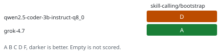

# herdr


This is the setup repo for [Herdr](https://herdr.dev). The status block is the current state of the harness. `./test.ts` rewrites that block and the pills. Do not edit them by hand.

<!-- status:start -->
## Status

| | |
| --- | --- |
| result | pass |
| cases | 30 |
| seconds | 10 |
| revision | a02f010+ |
| setup | 1 |

### Harness

One public script applies this Herdr config on a computer, then hands an agent the required /bootstrap prompt.



### Progress

| t | kind | name | status | detail |
| --- | --- | --- | --- | --- |
| 0s | run | arch | ok | macos |
| 0s | run | container-system | start |  |
| 0s | run | image-build | start | herdr-sandbox |
| 2s | run | image-build | ok | herdr-sandbox |
| 2s | run | container | start | herdr-test-10564 |
| 2s | run | container | ok | herdr-test-10564 |
| 5s | check | arch | ok |  |
| 5s | check | events | ok |  |
| 5s | check | skill | ok |  |
| 5s | check | herdr-skill | ok |  |
| 5s | check | skills-rule | ok |  |
| 5s | check | checklist | ok |  |
| 5s | check | bootstrap | ok |  |
| 5s | check | identity | ok |  |
| 5s | check | reviewer | ok |  |
| 5s | check | models | ok |  |
| 5s | check | evals | ok |  |
| 5s | check | setup | ok |  |
| 5s | check | tk | ok |  |
| 5s | check | pills | ok |  |
| 5s | check | status | ok |  |
| 5s | check | fresh | ok |  |
| 5s | check | idempotent | ok |  |
| 5s | check | drift | ok |  |
| 5s | check | linux | ok |  |
| 5s | check | windows | ok |  |
| 5s | check | unknown-os | ok |  |
| 5s | check | unwritable | ok |  |
| 5s | check | installer | ok |  |
| 5s | check | stamp | ok |  |
| 7s | check | live-apply | ok |  |
| 10s | check | live-config | ok |  |
| 10s | check | live-agents | ok |  |
| 10s | check | live-core | ok |  |
| 10s | check | live-worktree | ok |  |
| 10s | check | live-stop | ok |  |
| 10s | result | suite | pass |  |

### Memory

```text
container herdr-test-10564
memory 145.4 MiB / 1024.0 MiB
cpu_usec 1096006
pids 2
net_rx 29952491
net_tx 157641
block_read 120672256
block_write 0
```

### System

```text
container 1.5.0, arm64, cpus 8, running 2/2, images 6

disk:
TYPE           TOTAL  ACTIVE  SIZE     RECLAIMABLE
Images         6      2       7.48 GB  4.38 GB (59%)
Containers     2      2       4.02 GB  0 B (0%)
Local Volumes  0      0       0 B      0 B (0%)
```

### Grades

| model | where | skill-calling/bootstrap |
| --- | --- | --- |
| qwen2.5-coder-3b-instruct-q8_0 | local | D |
| grok-4.7 | cloud | A |
<!-- status:end -->

## Set up

One public script sets up the computer it is run on: macOS, Linux, Windows Git Bash, or WSL.

```text
deno run --allow-run --allow-read --allow-write --allow-net setup.ts
```

Run that from a checkout, or point `deno run` at the raw URL of `setup.ts`. The script runs `./apply`, then hands an agent the prompt to work with the human on `/bootstrap`. That handoff is required.

`./apply` copies the config and prints one JSON object. Exit `0` means `config/config.toml` is now the Herdr config. Exit `2` means the file is in place and Herdr itself is still missing. Exit `1` means the file was not applied. The `next` field says what to do. Do not guess past it.

The public script is the way this setup reaches a machine. Editing `~/.config/herdr/config.toml` (or `%APPDATA%\herdr\config.toml` on Windows) by hand drifts that computer off the herd. Change `config/config.toml`, bump the setup version, and run `./apply` again.

## What it sets

`config/config.toml` is the opinionated config. It is a small override, not a dump of every Herdr default:

- Skip first-run onboarding.
- 160×50 headless size for agent panes with no client attached.
- Login shells, so new panes see the normal PATH.
- Git worktrees under `~/.herdr/worktrees`.
- Prefix `ctrl+b`, plus the ctrl+alt chords Herdr documents as safe across terminals.
- Catppuccin, following the terminal light/dark appearance.
- Borders on, status by symbol and color, window title `{hostname}: {workspace}`.
- Sidebar rows show machine, workspace, tab, agent, and state.
- In-app toasts, which still work over SSH.

Product behavior that this file does not cover lives in the Herdr docs: <https://herdr.dev/docs/>.

## Layout

| Path | Role |
| --- | --- |
| `setup.ts` | The one public script. Runs `apply`, then hands an agent `/bootstrap`. |
| `apply` | Copies `config/config.toml` onto the machine. |
| `config/config.toml` | The config that `apply` copies. |
| `AGENTS.md` | How an agent sets a machine up with this repo. Read `README.md` first for current status. |
| `CONTRIBUTING.md` | Rules for changing the setup. |
| `test.ts` | The only test. Default arch `macos` runs the checks in an Apple container. It rewrites the status block. |
| `agents/independent-reviewer.md` | Reviews a change, or scores an agent run. |
| `evals/results.json` | Domains, evals, and the local and cloud grade for each. The score source. |
| `agents/models.md` | Grade table rendered from `evals/results.json`. |
| `badges/evals.svg` | Capability heatmap rendered from the same file. |
| `skills/` | One skill per tool. Official packages stay as published. |
| `badges/` | Pills for the last local test: result, cases, seconds. |

Run `./test.ts` before sending a change. `deno` must be on `PATH`. The report stays in four sections even when the test fails. The status block above is the record of that run.
