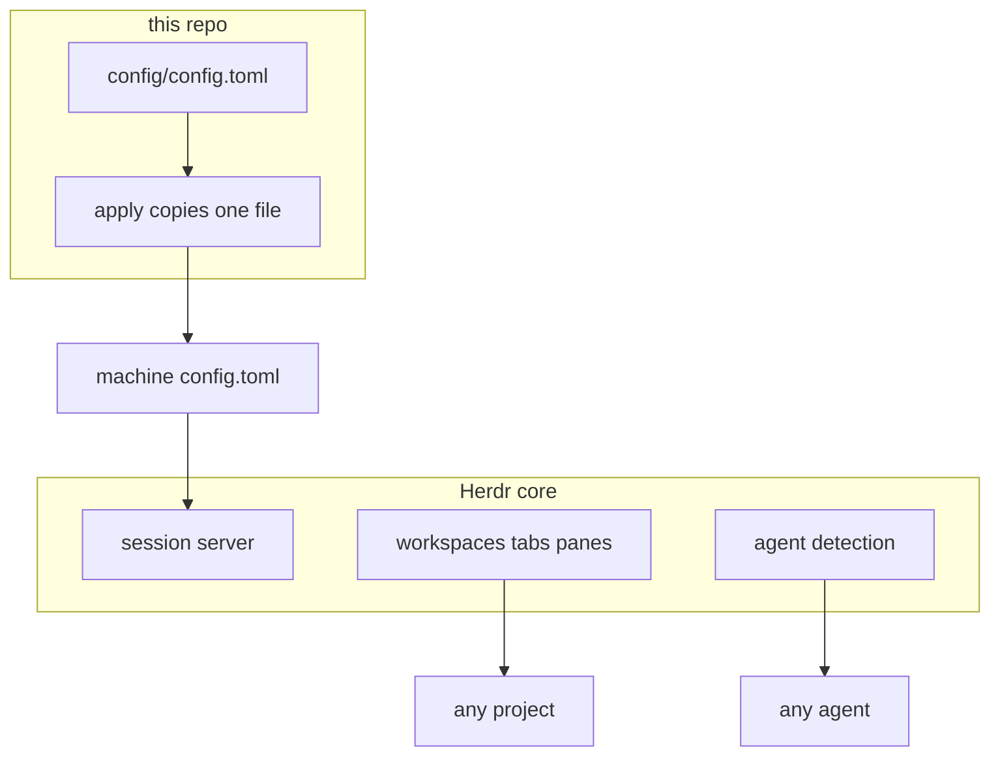
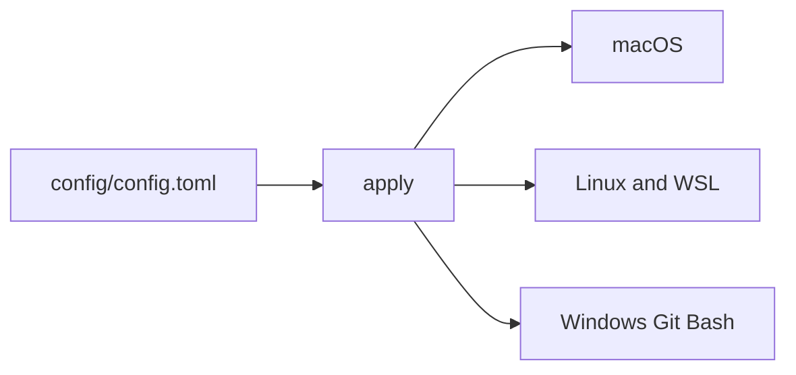

# herdr


Thin opinionated setup on [Herdr](https://herdr.dev) core. Same config for every agent, every project, every computer.

```text
deno run --allow-run --allow-read --allow-write --allow-net setup.ts
```

That runs `./apply` and prints a `/bootstrap` prompt. It does not start an agent or ship the Herdr binary.





`./evals.ts` rewrites the block and the pills below. The value list in that block is only scored agent runs. Do not edit them by hand.

<!-- status:start -->
## Status

| | |
| --- | --- |
| result | pass |
| cases | 32 |
| seconds | 13 |
| revision | 27a5f06+ |
| setup | 1 |

### Value

Agent-scored runs only. A core check is not value. Each setup version keeps its own matrix.

| setup | models | evals | scored |
| --- | --- | --- | --- |
| 1 | 2 | 1 | 2 |

| setup | where | model | eval | grade |
| --- | --- | --- | --- | --- |
| 1 | local | qwen2.5-coder-3b-instruct-q8_0 | skill-calling/bootstrap | D |
| 1 | cloud | grok-4.7 | skill-calling/bootstrap | A |

### Harness

One public script applies this Herdr config on a computer, then hands an agent the required /bootstrap prompt.


### Progress

| t | kind | name | status | detail |
| --- | --- | --- | --- | --- |
| 0s | run | arch | ok | macos |
| 0s | run | container-system | start |  |
| 0s | run | image-build | start | herdr-sandbox |
| 1s | run | image-build | ok | herdr-sandbox |
| 1s | run | container | start | herdr-test-30089 |
| 1s | run | container | ok | herdr-test-30089 |
| 4s | check | arch | ok |  |
| 4s | check | events | ok |  |
| 4s | check | skill | ok |  |
| 4s | check | herdr-skill | ok |  |
| 4s | check | ponytail | ok |  |
| 4s | check | repo-protection | ok |  |
| 4s | check | skills-rule | ok |  |
| 4s | check | checklist | ok |  |
| 4s | check | bootstrap | ok |  |
| 4s | check | identity | ok |  |
| 4s | check | reviewer | ok |  |
| 4s | check | models | ok |  |
| 4s | check | evals | ok |  |
| 4s | check | setup | ok |  |
| 4s | check | tk | ok |  |
| 4s | check | pills | ok |  |
| 4s | check | status | ok |  |
| 4s | check | fresh | ok |  |
| 4s | check | idempotent | ok |  |
| 4s | check | drift | ok |  |
| 4s | check | linux | ok |  |
| 4s | check | windows | ok |  |
| 4s | check | unknown-os | ok |  |
| 4s | check | unwritable | ok |  |
| 4s | check | installer | ok |  |
| 4s | check | stamp | ok |  |
| 13s | check | live-apply | ok |  |
| 13s | check | live-config | ok |  |
| 13s | check | live-agents | ok |  |
| 13s | check | live-core | ok |  |
| 13s | check | live-worktree | ok |  |
| 13s | check | live-stop | ok |  |
| 13s | result | suite | pass |  |

### Memory

```text
container herdr-test-30089
memory 143.3 MiB / 1024.0 MiB
cpu_usec 1414690
pids 2
net_rx 29965172
net_tx 224567
block_read 118149120
block_write 0
```

### System

```text
container 1.6.1, arm64, cpus 10, running 2/2, images 10

disk:
TYPE           TOTAL  ACTIVE  SIZE      RECLAIMABLE
Images         10     2       10.18 GB  9.36 GB (92%)
Containers     2      2       3.25 GB   0 B (0%)
Local Volumes  0      0       0 B       0 B (0%)
```

### Grades

| model | where | skill-calling/bootstrap |
| --- | --- | --- |
| qwen2.5-coder-3b-instruct-q8_0 | local | D |
| grok-4.7 | cloud | A |
<!-- status:end -->

## Defaults

One file, `config/config.toml`, on top of Herdr. Anything unset stays core behavior: <https://herdr.dev/docs/>.

- No onboarding. Headless panes are 160×50.
- Login shells. Worktrees at `~/.herdr/worktrees`.
- Prefix `ctrl+b`, plus the ctrl+alt chords.
- Catppuccin, following light and dark.
- Sidebar: machine, workspace, tab, agent, state. Toasts still show over SSH.

## Apply

| Exit | Meaning |
| --- | --- |
| `0` | The file matches. A running server has loaded it only when `reload` is `reloaded`. |
| `2` | The file is in place. Install Herdr from <https://herdr.dev/docs/install/>, then `./apply`. Do not rewrite the config. |
| `1` | Follow `next`. |

Live file: `~/.config/herdr/config.toml`, or `%APPDATA%\herdr\config.toml` on Windows. Do not hand-edit it.

## Map

| Path | Role |
| --- | --- |
| `setup.ts` | Runs `apply`, then prints the `/bootstrap` prompt. |
| `apply` | Copies `config/config.toml`. Prints one JSON report. |
| `config/config.toml` | The wrapper. `herdr-setup` matches `SETUP_VERSION` in `apply`. |
| `AGENTS.md` | How an agent sets a machine up. |
| `CONTRIBUTING.md` | How a change is made. |
| `skills/` | `ponytail` is required. `turnkey-tk` stays the upstream package. `repo-protection` is the lock. |

`./evals.ts` is the only eval runner. It rewrites this status block.

## Changes

- Bump `SETUP_VERSION` and the `herdr-setup` stamp together.
- Push a branch. No direct push to `main`. Secrets go through `tk` only.
