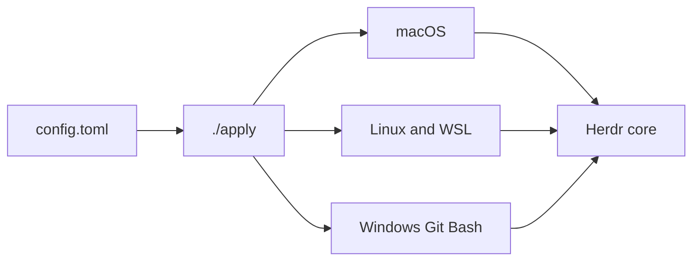

# herdr


Thin opinionated setup on [Herdr](https://herdr.dev) core. Same config for every agent, every project, every computer.

```text
deno run --allow-run --allow-read --allow-write --allow-net setup.ts
```

That runs `./apply` and prints a `/bootstrap` prompt. It does not start an agent or ship the Herdr binary.



`./evals.ts` rewrites the block and the pills below. The value list in that block is only scored agent runs. Do not edit them by hand.

<!-- status:start -->
## Status

| | |
| --- | --- |
| result | fail |
| cases | 0 |
| seconds | 5 |
| revision | f2793b1+ |
| setup | 1 |

### Value

Agent-scored runs only. A core check is not value. Each setup version keeps its own matrix.

| setup | models | evals | scored |
| --- | --- | --- | --- |
| 1 | 2 | 1 | 2 |

| setup | where | model | eval | grade |
| --- | --- | --- | --- | --- |
| 1 | local | qwen2.5-coder-3b-instruct-q8_0 | skill-calling/bootstrap | D |
| 1 | cloud | grok-4.7 | skill-calling/bootstrap | A |

### Harness

One public script applies this Herdr config on a computer, then hands an agent the required /bootstrap prompt.


### Progress

| t | kind | name | status | detail |
| --- | --- | --- | --- | --- |
| 0s | run | container-system | start |  |
| 0s | run | image-build | start | herdr-sandbox |
| 1s | run | image-build | ok | herdr-sandbox |
| 1s | run | container | start | herdr-test-42454 |
| 2s | run | container | ok | herdr-test-42454 |
| 5s | result | suite | fail | 126 |

### Memory

```text
container herdr-test-42454
memory 4.3 MiB / 1024.0 MiB
cpu_usec 5346
pids 1
net_rx 142
net_tx 602
block_read 3563520
block_write 0
```

### System

```text
container 1.6.1, arm64, cpus 10, running 3/3, images 10

disk:
TYPE           TOTAL  ACTIVE  SIZE      RECLAIMABLE
Images         10     3       12.43 GB  11.56 GB (93%)
Containers     3      3       5.14 GB   0 B (0%)
Local Volumes  0      0       0 B       0 B (0%)
```

### Grades

| model | where | skill-calling/bootstrap |
| --- | --- | --- |
| qwen2.5-coder-3b-instruct-q8_0 | local | D |
| grok-4.7 | cloud | A |
<!-- status:end -->

## Defaults

One file, `config.toml`, on top of Herdr. Anything unset stays core behavior (<https://herdr.dev/docs/>):

- Onboarding off; headless panes `160×50`.
- Login shells; worktrees at `~/.herdr/worktrees`.
- Prefix `ctrl+b`, plus `ctrl+alt` chords.
- Catppuccin Mocha (dark) and Latte (light), following system appearance.
- Sidebar shows machine, workspace, tab, agent, and state; notifications and toasts stay enabled over SSH.

## Apply

See `AGENTS.md` for machine setup, exit codes (`0`, `2`, `1`), and JSON report fields. Live destination: `~/.config/herdr/config.toml` (macOS/Linux) or `%APPDATA%\herdr\config.toml` (Windows Git Bash). Do not hand-edit the live file.

## Map

| Path | Role |
| --- | --- |
| `setup.ts` | Public entry script: runs `./apply`, then prints the required `/bootstrap` prompt. |
| `apply` | Idempotent config applier (`macOS`, `Linux`, `Windows Git Bash`). Emits one JSON report. |
| `config.toml` | Herdr config (`herdr-setup:` stamp matches `SETUP_VERSION` in `apply`). |
| `evals.ts` | Single eval runner (`macos` Apple container or `linux` Docker). Rewrites this status block and `badges/`. |
| `eval-results.json` | Agent capability grades per `SETUP_VERSION`, rendered into `agents/models.md` and `badges/evals.svg`. |
| `sandbox` | Read-only container build context (`sandbox/Containerfile`) used by `evals.ts`. |
| `AGENTS.md` | Machine setup rules and agent invocation. |
| `CONTRIBUTING.md` | Repo change, skill, eval, and merge rules. |
| `agents/` | `independent-reviewer.md` prompt and rendered `models.md` grade matrix. |
| `skills/` | Committed tool skills and their `CHECKLIST.md` decision files (`herdr`, `turnkey-tk`, `container`, `ponytail`, `repo-protection`, `agent-ready`, `author-skill`). |

## Changes

See `CONTRIBUTING.md` for full change rules:

- Bump `SETUP_VERSION` in `apply` and the `herdr-setup:` stamp in `config.toml` together.
- Sign all commits (`skills/repo-protection/SKILL.md`), handle secrets only with `tk` (`skills/turnkey-tk/SKILL.md`), and run `./evals.ts` before merging.
