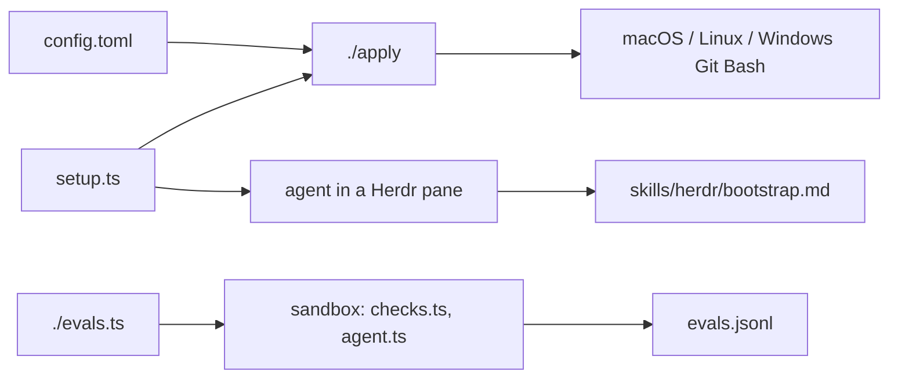

# herdr

Purpose: what this repo is, the one command, how it fits together, every file, and the latest agent eval results.
Change when: the command, the file list, or what the project does changes. The results block changes only through `./evals.ts macos --agent`.
Not for: machine setup and report fields (`AGENTS.md`), change rules (`CONTRIBUTING.md`).

One opinionated config for [Herdr](https://herdr.dev), the terminal multiplexer for coding agents. The same setup for every agent, project, and computer.

```text
deno run --reload --allow-run --allow-read --allow-write --allow-net --allow-env https://raw.githubusercontent.com/tyler-jewell/herdr/main/setup.ts --agent <kind>
```

That clones this repo if needed and runs `./apply`, which installs Herdr and puts `config.toml` in place. Then it hands the `/bootstrap` prompt to an agent of the kind you name, started beside you when you run it in a Herdr pane.

## How it works



## Files

| File | What it is |
| --- | --- |
| `AGENTS.md` | Read first by every agent: machine setup, the report fields, the agents. |
| `CONTRIBUTING.md` | The rules for changing this repo. |
| `REVIEWER.md` | The independent reviewer: change review and run scoring. |
| `setup.ts` | The one public entry. |
| `apply` | Copies `config.toml` onto the machine, installs Herdr if missing, reloads it. |
| `config.toml` | The Herdr config every machine runs. |
| `evals.ts` | The eval runner: builds the sandbox and runs checks, a shell, or the agent eval. |
| `Containerfile` | The sandbox image. |
| `checks.ts` | Behavior checks, run in the sandbox. |
| `agent.ts` | The agent eval: Pi inside Herdr on a local model, judged by a second local model. |
| `results.ts` | Result rows, metrics, validation, and the block below. |
| `lib.ts` | Helpers shared by the scripts. |
| `evals.json` | The evals, the two local models, and the judge's option lists. |
| `evals.jsonl` | One row per scored run, with both sessions inline. |
| `skills/` | The skills agents use, each with our `CHECKLIST.md` of decisions. |
| `.github/workflows/test.yml` | Runs `./evals.ts` on every push. |

## Results

<!-- results:start -->

Rendered by `./evals.ts macos --agent` from `evals.jsonl`: the latest run per setup, eval, and model. Do not edit.

No scored runs yet.

<!-- results:end -->
