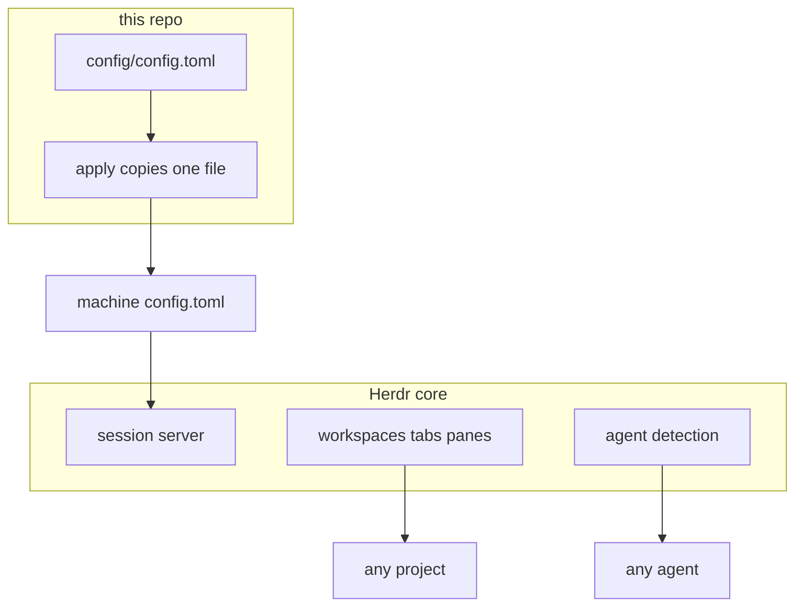
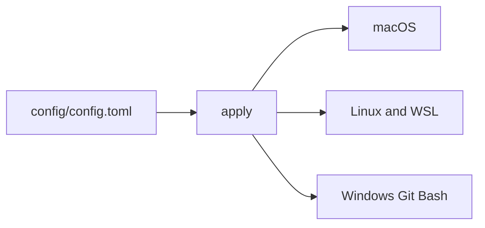

# herdr


Thin opinionated setup on [Herdr](https://herdr.dev) core. Same config for every agent, every project, every computer.

```text
deno run --allow-run --allow-read --allow-write --allow-net setup.ts
```

That runs `./apply` and prints a `/bootstrap` prompt. It does not start an agent or ship the Herdr binary.





`./test.ts` rewrites the block and the pills below. Do not edit them by hand.

<!-- status:start -->
## Status

| | |
| --- | --- |
| result | pass |
| cases | 32 |
| seconds | 17 |
| revision | aa32ba5+ |
| setup | 1 |

### Harness

One public script applies this Herdr config on a computer, then hands an agent the required /bootstrap prompt.


### Progress

| t | kind | name | status | detail |
| --- | --- | --- | --- | --- |
| 0s | run | arch | ok | macos |
| 0s | run | container-system | start |  |
| 1s | run | image-build | start | herdr-sandbox |
| 2s | run | image-build | ok | herdr-sandbox |
| 2s | run | container | start | herdr-test-17423 |
| 3s | run | container | ok | herdr-test-17423 |
| 5s | check | arch | ok |  |
| 5s | check | events | ok |  |
| 5s | check | skill | ok |  |
| 5s | check | herdr-skill | ok |  |
| 5s | check | ponytail | ok |  |
| 5s | check | repo-protection | ok |  |
| 5s | check | skills-rule | ok |  |
| 5s | check | checklist | ok |  |
| 5s | check | bootstrap | ok |  |
| 5s | check | identity | ok |  |
| 5s | check | reviewer | ok |  |
| 5s | check | models | ok |  |
| 5s | check | evals | ok |  |
| 5s | check | setup | ok |  |
| 5s | check | tk | ok |  |
| 5s | check | pills | ok |  |
| 5s | check | status | ok |  |
| 5s | check | fresh | ok |  |
| 5s | check | idempotent | ok |  |
| 5s | check | drift | ok |  |
| 5s | check | linux | ok |  |
| 5s | check | windows | ok |  |
| 5s | check | unknown-os | ok |  |
| 5s | check | unwritable | ok |  |
| 5s | check | installer | ok |  |
| 5s | check | stamp | ok |  |
| 17s | check | live-apply | ok |  |
| 17s | check | live-config | ok |  |
| 17s | check | live-agents | ok |  |
| 17s | check | live-core | ok |  |
| 17s | check | live-worktree | ok |  |
| 17s | check | live-stop | ok |  |
| 17s | result | suite | pass |  |

### Memory

```text
container herdr-test-17423
memory 145.3 MiB / 1024.0 MiB
cpu_usec 1262121
pids 2
net_rx 29963646
net_tx 278648
block_read 120610816
block_write 0
```

### System

```text
container 1.5.0, arm64, cpus 8, running 2/2, images 6

disk:
TYPE           TOTAL  ACTIVE  SIZE     RECLAIMABLE
Images         6      2       7.48 GB  4.38 GB (59%)
Containers     2      2       4.02 GB  0 B (0%)
Local Volumes  0      0       0 B      0 B (0%)
```

### Grades

| model | where | skill-calling/bootstrap |
| --- | --- | --- |
| qwen2.5-coder-3b-instruct-q8_0 | local | D |
| grok-4.7 | cloud | A |
<!-- status:end -->

## Defaults

One file, `config/config.toml`, on top of Herdr. Anything unset stays core behavior: <https://herdr.dev/docs/>.

- No onboarding. Headless panes are 160×50.
- Login shells. Worktrees at `~/.herdr/worktrees`.
- Prefix `ctrl+b`, plus the ctrl+alt chords.
- Catppuccin, following light and dark.
- Sidebar: machine, workspace, tab, agent, state. Toasts still show over SSH.

## Apply

| Exit | Meaning |
| --- | --- |
| `0` | The file matches. A running server has loaded it only when `reload` is `reloaded`. |
| `2` | The file is in place. Install Herdr from <https://herdr.dev/docs/install/>, then `./apply`. Do not rewrite the config. |
| `1` | Follow `next`. |

Live file: `~/.config/herdr/config.toml`, or `%APPDATA%\herdr\config.toml` on Windows. Do not hand-edit it.

## Map

| Path | Role |
| --- | --- |
| `setup.ts` | Runs `apply`, then prints the `/bootstrap` prompt. |
| `apply` | Copies `config/config.toml`. Prints one JSON report. |
| `config/config.toml` | The wrapper. `herdr-setup` matches `SETUP_VERSION` in `apply`. |
| `AGENTS.md` | How an agent sets a machine up. |
| `CONTRIBUTING.md` | How a change is made. |
| `skills/` | `ponytail` is required. `turnkey-tk` stays the upstream package. `repo-protection` is the lock. |

`./test.ts` is the only test. It rewrites this status block.

## Changes

- Bump `SETUP_VERSION` and the `herdr-setup` stamp together.
- Push a branch. No direct push to `main`. Secrets go through `tk` only.
