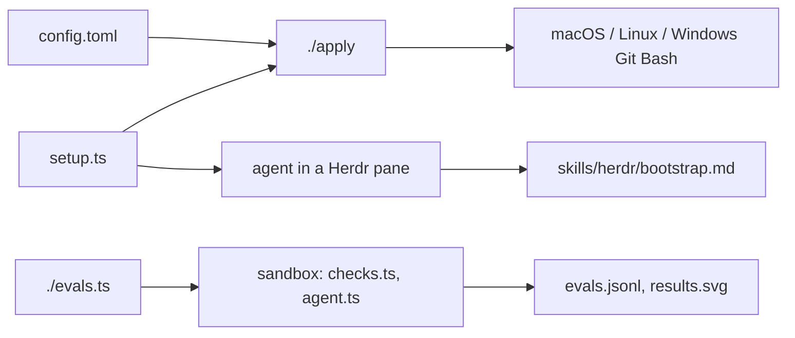

<!--
Purpose: what this repo is, why to use it, the one command, the live results, how it fits together, and every file.
Change when: the pitch, the command, the file list, or how it works changes. The results block changes only through `./evals.ts macos --agent`.
Not for: machine setup and report fields (AGENTS.md), change rules (CONTRIBUTING.md).
-->

# herdr

**One [Herdr](https://herdr.dev) setup for every coding agent, project, and computer, with every commit tested by an agent.**

Herdr runs coding agents side by side in a terminal. This repo is an opinionated, versioned setup for it. One command installs Herdr on macOS, Linux, or Windows, puts the same config in place everywhere, and hands a new machine to an agent that sets it up with you.

```text
deno run --reload --allow-run --allow-read --allow-write --allow-net --allow-env https://raw.githubusercontent.com/tyler-jewell/herdr/main/setup.ts --agent <kind>
```

Run it in a Herdr pane, and the agent you named (`pi`, `claude`, `codex`, `grok`, …) starts beside you on the `/bootstrap` prompt. Anywhere else, it prints the prompt.

## Proof, per commit

Each commit is evaluated by an agent doing real work. [Pi](https://www.npmjs.com/package/@mariozechner/pi-coding-agent) runs inside Herdr, inside a locked-down container, on a local model. A second local model then reads the whole session and scores it 1-10 against [10 capabilities](capabilities.json), while [10 metrics](metrics.json) are measured automatically. No cloud, no keys. Everything below is generated from [`evals.jsonl`](evals.jsonl).

<!-- results:start -->

No scored runs yet. `./evals.ts macos --agent` records one for the current commit.

<!-- results:end -->

## How it works



- **Same everywhere.** `./apply` copies `config.toml` byte for byte, backs up whatever it replaces, and reports in JSON. Run it twice and nothing changes.
- **Checked on every push.** `./evals.ts` runs the behavior checks in a read-only, unprivileged container on macOS and Linux.
- **Scored on every commit.** `./evals.ts macos --agent` runs the agent eval and records one row per commit.

## Files

| File | What it is |
| --- | --- |
| `AGENTS.md` | Read first by every agent: machine setup, the report fields, the agents. |
| `CONTRIBUTING.md` | The rules for changing this repo, including how evals run. |
| `REVIEWER.md` | The independent reviewer: change review and run scoring. |
| `setup.ts` | The one public entry. |
| `apply` | Copies `config.toml` onto the machine, installs Herdr if missing, reloads it. |
| `config.toml` | The Herdr config every machine runs. |
| `metrics.json` | The 10 metrics measured on every run. |
| `capabilities.json` | The 10 capabilities the judge scores 1-10, and its scale. |
| `evals.json` | The evals, the two local models, and the judge's labels. |
| `evals.jsonl` | One row per scored commit, with both sessions inline. |
| `results.svg` | The heatmap above, generated. |
| `evals.ts` | The eval runner: builds the sandbox and runs checks, a shell, or the agent eval. |
| `Containerfile` | The sandbox image. |
| `checks.ts` | Behavior checks, run in the sandbox. |
| `agent.ts` | The agent eval, run in the sandbox. |
| `results.ts` | Result rows, metrics, and validation. |
| `render.ts` | Draws the results block and `results.svg`. |
| `lib.ts` | Helpers shared by the scripts. |
| `skills/` | The skills agents use, each with our `CHECKLIST.md` of decisions. |
| `.github/workflows/test.yml` | Runs `./evals.ts` on every push. |
